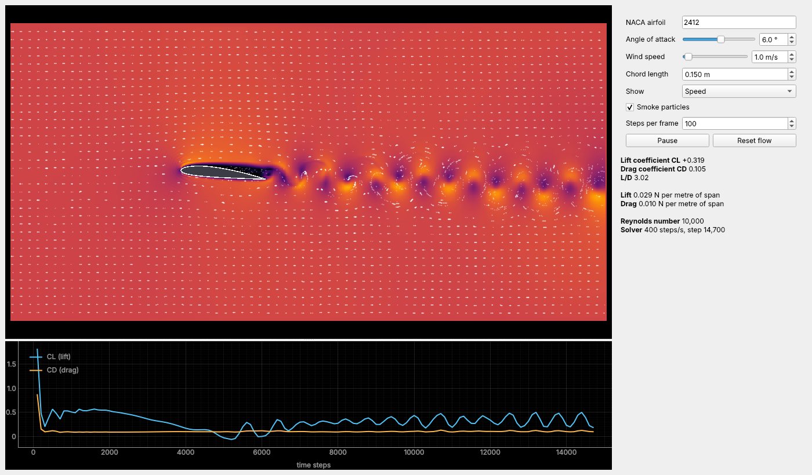

# WingSim

A virtual wind tunnel for testing wings. This first milestone is a 2D tunnel
for NACA airfoils: pick a section, change the angle of attack and wind speed
while it runs, and watch the flow and the lift and drag respond live.



## Run it

Python 3.10 or newer.

```bash
python -m venv .venv
source .venv/bin/activate        # Windows: .venv\Scripts\activate
pip install -r requirements.txt
python -m wingsim
```

The first launch takes a few seconds while Numba compiles the solver. Later
launches use the cached build.

### Running on an NVIDIA GPU

WingSim uses an NVIDIA GPU automatically when it finds one. You need a recent
NVIDIA driver (version 525 or newer, which supports CUDA 12). Install the GPU
packages once:

```bash
pip install -r requirements-gpu.txt
python -m wingsim
```

The Solver line in the side panel shows which device is running, for example
`GPU (NVIDIA GeForce RTX 4070)`. If the GPU can't be used, the app prints the
reason in the terminal and runs on the CPU instead. To force the CPU, run
`python -m wingsim --cpu`.

The CUDA toolkit comes from pip, so you don't need to install it separately.
On Windows, use a normal Python install, not WSL, unless WSL already has GPU
access set up.

## What you can change

| Control | What it does |
|---|---|
| NACA airfoil | Any 4-digit section, such as 0012, 2412 or 4415 |
| Angle of attack | Rotates the wing about its quarter chord, live |
| Wind speed, chord | Set the Reynolds number and the lift and drag in newtons |
| Show | Speed, vorticity or pressure coefficient |
| Smoke particles | Tracers released from rakes at the inlet |

The panel reports CL, CD, L/D, lift and drag per metre of span, and the
Reynolds number. The plot under the flow shows CL and CD over time, so you can
see vortex shedding when the wing starts to stall.

## How the physics works

The fluid solver is a D2Q9 **Lattice Boltzmann** method (`wingsim/lbm.py`).
Instead of solving the Navier-Stokes equations directly, it tracks particle
populations moving between grid cells and colliding. At low Mach number this
recovers incompressible Navier-Stokes flow. It suits this project because each
cell updates on its own, so it parallelises across CPU cores now and maps
directly onto a GPU later.

* Collision: BGK with a Smagorinsky subgrid model, so higher Reynolds numbers stay stable.
* Walls: half-way bounce-back on the cells inside the airfoil.
* Forces: momentum exchange across every fluid-to-wall link, giving lift and drag directly.
* Boundaries: uniform inflow on the left, free-stream far field top and bottom, open outlet on the right.
* Speed: Numba compiles the kernel and runs it on all CPU cores, or on an NVIDIA
  GPU with Numba CUDA (`wingsim/lbm_gpu.py`), one GPU thread per cell in single precision.

### Accuracy and limits

* For a NACA 0012 at Re 1000 and 0 degrees the solver gives CD = 0.131.
  [Published LBM and XFOIL results](https://arxiv.org/abs/2006.10487) give 0.119.
  The difference comes from the stair-stepped wall and the finite tunnel size.
* The grid is 560 x 280 cells with an 80-cell chord. That resolves the flow up to
  about Re 20,000. Real wings at everyday speeds run at Re in the hundreds of
  thousands. When your settings exceed the limit the app runs at Re 20,000 and
  says so. Expect lower lift slopes and higher drag than textbook high-Re data.
* The flow is 2D, so it models an infinitely long wing with no tip vortices.

## Tests

```bash
pip install pytest
python -m pytest
```

The GPU test runs on a real GPU when one is present. Without one, check the GPU
kernels against the CPU solver with Numba's simulator:
`NUMBA_ENABLE_CUDASIM=1 python -m pytest tests/test_lbm_gpu.py`.

## Roadmap

1. Airfoil wind tunnel (this milestone)
2. Finer grids on the GPU for higher Reynolds numbers
3. 3D wings with span, taper and tip vortices
4. Bird wing shapes and flapping
5. Human-scale wings, with every parameter adjustable live
